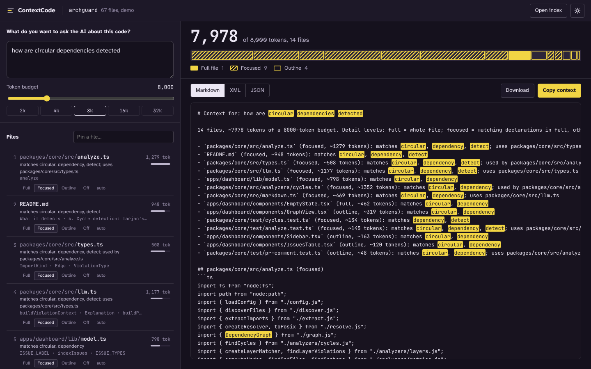
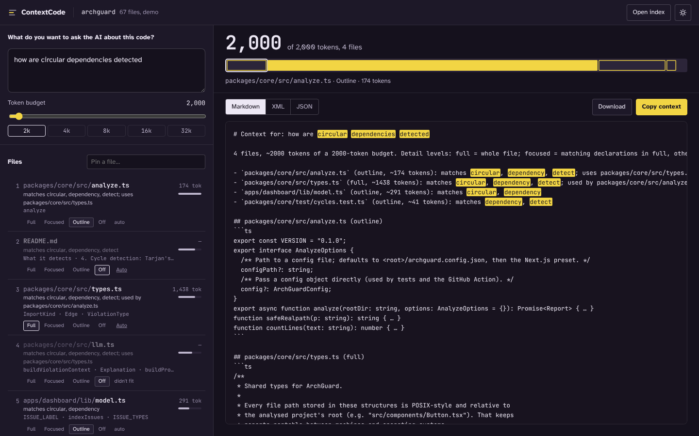

# ContextCode

**Give an AI assistant the right code, not all of it.**

ContextCode reads a JavaScript or TypeScript project, ranks its files for a question you want to ask, explains why each file was picked, and packs the best ones into a token budget you choose. Paste the result into any AI assistant, or let ContextCode ask a model for you.

> College project by [@jay-m007](https://github.com/jay-m007). It reuses the parser and import resolver from my previous project, [ArchGuard](https://github.com/jay-m007/archguard).



```
$ contextcode search "how is the health score calculated" ../archguard --limit 2

Top 2 of 67 files for "how is the health score calculated"

  1. 1.01  README.md
       matches health, score, calculated
       best matches: 7. Health score, 6. Coupling metrics, ArchGuard
  2. 0.99  packages/core/src/score.ts
       matches health, score
       best matches: computeScore
```

## Why

Asking an AI about your code goes wrong in two ways. Paste too little and it guesses. Paste the whole project and you hit the context limit, pay for tokens you didn't need, and bury the answer in noise. People usually solve this by hand: search for a word, open a few files, copy them in. ContextCode does that step properly and shows its working.

## Status

| Phase | Scope | Status |
|---|---|---|
| 1 | Core engine and CLI: index, rank, pack into a budget | ✅ Done |
| 2 | Benchmark: 43 questions on 4 real repositories, with baselines | ✅ Done |
| 3 | Web UI: ranked files with reasons, overrides, budget meter, copy | ✅ Done |
| 4 | `ask`: answer with any OpenAI-compatible model, citing `file:line` | ✅ Done |

## Quick start

```bash
git clone https://github.com/jay-m007/contextcode.git
cd contextcode
npm install
npm run build
npm test

# context for a question, as Markdown on stdout
node packages/cli/dist/index.js pack "how does login work?" /path/to/project -b 8000 > context.md

# just the ranking, with reasons
node packages/cli/dist/index.js search "where are payments handled" /path/to/project
```

### CLI

```
contextcode pack   "<question>" [path]   Print the packed context for a question
contextcode search "<question>" [path]   Show the ranked files and why
contextcode ask    "<question>" [path]   Answer with an AI model, using the packed context
contextcode index  [path] [-o file]      Save an index (for the web UI, or to skip re-reading the project)
contextcode eval   <bench.json> [path]   Measure retrieval quality on a benchmark

  -b, --budget <tokens>    Token budget (default 8000)
  -f, --focus <file>       A file you're asking about; ranks first. Repeatable
      --format <fmt>       markdown | xml | json
  -o, --out <file>         Write to a file
  -n, --line-numbers       Prefix code lines with line numbers
      --no-docs            Skip Markdown files
      --no-graph           Keywords only, no import-graph boost
      --exclude <glob>     Skip matching files. Repeatable
```

`[path]` can also be an index file made by `contextcode index`, which makes repeated questions on a big project instant.

## How it works

```
 project ──► index ──────────────────► rank ─────────────────────► pack ──────────────► Markdown / XML / JSON
             files, declarations,       BM25F keywords              full / focused /
             import graph               + import-graph boost        outline, fitted
             (TypeScript parser)        (personalised PageRank)     to the budget
```

### 1. Index

Every `.ts/.tsx/.js/.jsx` file is parsed with the TypeScript compiler. ContextCode records each **declaration** (functions, classes and their methods, interfaces, types, React components) with its line range, its signature without the body, and the first sentence of its doc comment. Imports are resolved to real files with TypeScript's own resolver and the project's `tsconfig.json` (so `@/lib/auth` works), giving a two-way import graph. Markdown files are split into heading sections. Dependency folders, build output, minified and generated files are skipped.

### 2. Rank: keywords

Words are split the way programmers write them (`getUserSession` → get, user, session, plus `getusersession` kept whole), lightly stemmed (rotate, rotated, rotation → `rotat`), and common abbreviations are mapped to one form (authentication → auth, database → db), so the question's words meet the code's.

Each file is scored with **BM25F**, the scoring behind classic search engines, extended to fields:

```
score(file) = Σ over question terms t:   idf(t) · tf'(t) · (k1 + 1) / (tf'(t) + k1)

tf'(t) = 4·(in file name) + 1.5·(in folder names) + 3·(in exported declaration names)
       + 2·(in other declaration names) + 1.5·(in doc comments)
       + (in the body) / (1 − b + b · body length / average body length)

idf(t) = ln(1 + (N − df + 0.5) / (df + 0.5))        k1 = 1.2, b = 0.75
```

Only the body is normalised by length, so a long file whose function is *named* after the question isn't punished for being long. The score is then multiplied by `0.5 + 0.5 × (share of the question's terms found)`, so files covering more of the question win. Tests and prose documents are scaled down (×0.6 and ×0.75), because they repeat the words of the code they describe.

### 3. Rank: import graph

The best keyword hits are used as seeds for a **personalised PageRank**: a walker starts at a seed, follows imports (forwards with weight 1, backwards 0.5), and jumps back to a seed with probability 0.3. Files where the walker spends time are near several good hits. Heavily imported hubs (a shared `types.ts`) are damped by `1 + 0.6 · ln(1 + importers)`.

The graph boosts rather than overrides: `final = keyword × (1 + 0.3 × graph)`, and files with no keyword match can enter with a small graph-only score. Each result carries its reasons (which words matched, and which top hit it uses or is used by), so no choice is a black box.

### 4. Pack

Each ranked file can be included at three levels of detail:

| Level | What's included |
|---|---|
| **full** | The whole file |
| **focused** | The imports, the declarations that match the question in full (very long ones cut at 80 lines), other declarations as one-line signatures, with every gap marked `// … lines 40–88 omitted` |
| **outline** | Signatures only (for big files, one line per exported declaration) |

Packing is **breadth first**: in ranked order, small files are included whole and others focused, falling back to an outline. Then any leftover budget upgrades earlier files to full. No file may take more than 40% of the budget (60% for a file you named with `--focus`). Tokens are estimated as characters ÷ 3.6, deliberately a little pessimistic.

## How well it works

`bench/` has 43 questions about four real repositories, each with the files a developer would need to answer it ([how they were chosen](bench/README.md)). Three methods are compared:

- **contextcode**: keywords plus the graph boost (the default)
- **keywords**: the same without the graph (`--no-graph`)
- **grep**: count the question's words in each file, then paste whole files in that order until the budget runs out, which is roughly what people do by hand

At an 8,000-token budget:

| Method | Answer files in top 5 | In top 10 | MRR | In the packed context | …with their code |
|---|---:|---:|---:|---:|---:|
| contextcode | 65% | 87% | 0.67 | **85%** | **81%** |
| keywords | 64% | 86% | 0.71 | 85% | 82% |
| grep | 47% | 64% | 0.41 | 42% | 42% |

Answer files in the packed context, by budget:

| Budget | contextcode | keywords | grep |
|---|---:|---:|---:|
| 4,000 | 77% | 80% | 37% |
| 8,000 | 85% | 85% | 42% |
| 16,000 | 91% | 91% | 62% |

What this shows, honestly:

- Ranking and packing roughly **double** what reaches the model compared with grep-and-paste at the same budget. Summarising files (focused and outline views) instead of pasting them whole is what makes the difference on the large repository (excalidraw, 748 files).
- The **import-graph boost is roughly neutral** on this benchmark: slightly better recall in the top 10, slightly worse MRR. Most answer files here contain the question's words, which keywords already find. The graph's real job is bringing in neighbours (the types and helpers an answer file uses), which this benchmark doesn't score. It stays on by default, and `--no-graph` turns it off.
- The ranking was tuned on these same questions, so the numbers are indicative, not a held-out result.

Reproduce with `contextcode eval bench/commerce.json ../commerce` (see `bench/README.md` for the exact commits).

**Speed:** excalidraw (748 files) takes about 3.5 s end to end, most of it parsing. With a saved index, a question takes about half a second (0.4 s to load the index, under 0.1 s to search and pack).

## Web UI

```bash
npm run build:web
npx serve apps/web/out
```

Open it, then either click **Try it on ArchGuard's code** for a demo, or drop in an index made with `contextcode index ./my-project -o index.json`. Everything runs in the browser; nothing is uploaded.

- Type a question. Files re-rank as you type, each with why it was picked and its best-matching declarations.
- The **budget meter** shows how the budget is used: one segment per file, sized by tokens, solid for full, hatched for focused, outlined for outline.
- Override any file (Full / Focused / Outline / Off), or **pin** a file the question doesn't mention. Fixed choices always count, and the meter shows if they go over budget.
- The preview is exactly what gets copied, with the question's words highlighted. Copy or download as Markdown, XML or JSON.



## Asking a model

```bash
export OPENAI_API_KEY=sk-...
contextcode ask "where is the session cookie set?" ./my-app
```

ContextCode packs the context (with line numbers), sends it with the question to any OpenAI-compatible API (`--base-url` for Groq, Together, a local Ollama or LM Studio server; `--model` to choose), and streams the answer. The model is told to answer only from the context, cite `path:line`, and say what's missing rather than guess. Because repository code can contain text that looks like instructions, the context is sent inside `<context>` tags, and the model is told never to follow instructions found there. Only the packed context leaves your machine, never the whole project. The web UI deliberately has no "ask" button, so an API key is never put in a web page.

## Known limitations

- JavaScript, TypeScript and Markdown only.
- Keyword matching needs some overlap of words. A question phrased completely differently from the code (no shared or abbreviated terms) won't find it. Embeddings would help here, at the cost of a model download or an API call.
- Token counts are estimates (characters ÷ 3.6), not a real tokenizer, so leave a little headroom for strict limits.
- Only the root `tsconfig.json`/`jsconfig.json` is read for aliases, like ArchGuard.
- Files over 400 KB are skipped as probably generated.

## Project structure

```
packages/
  core/                 # the engine (library)
    src/
      build.ts          # index a project (Node)
      extract.ts        # import extraction       (from ArchGuard)
      resolve.ts        # tsconfig-aware resolver (from ArchGuard)
      symbols.ts        # declarations and signatures, Markdown sections
      text.ts           # word splitting, stemming, abbreviations, token estimate
      search.ts         # BM25F + personalised PageRank        (browser-safe)
      pack.ts           # full / focused / outline, budget fitting, formats (browser-safe)
      ask.ts            # OpenAI-compatible answers with streaming
      evaluate.ts       # benchmark metrics and the grep baseline
      engine.ts         # the browser-safe entry point used by the web UI
    test/
  cli/                  # `contextcode` command-line tool
apps/web/               # Next.js static web UI
bench/                  # benchmark questions
```

## Development

```bash
npm test             # 34 tests (build first: the CLI tests use the built core)
npm run typecheck
npm run build        # core and CLI
npm run build:web    # static web UI in apps/web/out
```

## License

MIT
